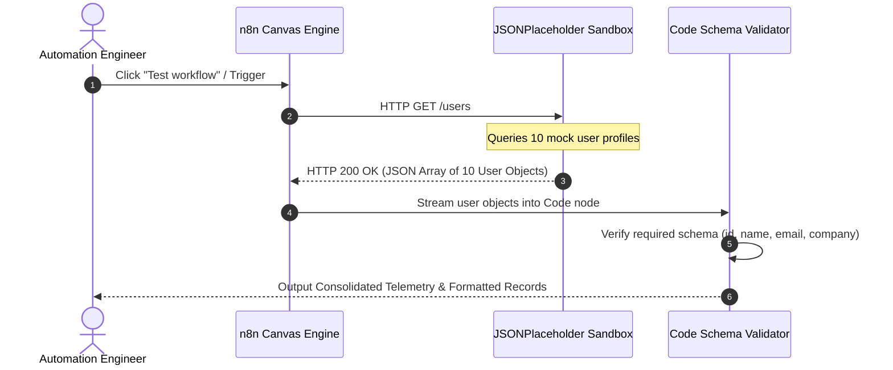

# Topic 1: Setting Up Your API Development Environment

> **Institution:** Tayana Academy | LMS Assessment & Hands-On Engineering Guide  
> **Course:** n8n Workflow Automation & API Engineering — Level 1 (Foundations)  
> **Topic / Assessment:** Topic 1: Setting Up Your API Development Environment  
> **Workflow Name:** `My First API GET Workflow`  
> **Target Audience:** Integration Engineers, Automation Trainees & Backend Developers  
> **Difficulty Level:** Level 1 (Foundations)  
> **Platform Version:** n8n version 1.0.0 or higher / Postman v10+  
> **Student:** Abhishek Nikam (`abhishek.n@tayanasolutions.com`)  
> **Repository:** [topic-01-setting-up-api-development-environment](https://github.com/abhisheknikam3/topic-01-setting-up-api-development-environment)  

---

## 1. Executive Summary & Objective

In modern distributed automation and enterprise integration, mastering API consumption and visual workflow orchestration begins with establishing a robust local and cloud-based development environment. Before orchestrating multi-system pipelines, engineers must be proficient with fundamental HTTP REST methodologies, client tooling (Postman), visual workflow canvas engines (n8n), and JSON payload validation.

### Core Objectives
1. **Tooling Provisioning:** Download, install, and configure an industry-standard API client (Postman) and establish an isolated personal workspace (`n8n_API_Trainee_Workspace`).
2. **Workflow Engine Deployment:** Deploy the n8n visual automation engine either via n8n Cloud or self-hosted locally on Node.js runtime (`npm install n8n -g`).
3. **Public Mock Sandbox Integration:** Target a zero-blocker, zero-credential public REST API sandbox ([JSONPlaceholder](https://jsonplaceholder.typicode.com)) to query mock entities safely.
4. **Interactive Verification in Postman:** Execute baseline `GET` queries, analyze HTTP status headers (`200 OK`), inspect round-trip transit times (ms), and validate payload structures.
5. **Visual Orchestration in n8n:** Build `My First API GET Workflow` using a **Manual Trigger**, an **HTTP Request** node, and an automated schema validation node to inspect and format parsed user records.

---

## 2. Canvas Architecture & Workflow Topology

### 2.1 ASCII Canvas Architecture

```
[ MANUAL INVOCATION ]
   [ Manual_Trigger ]
          │
          ▼
[ REST API INGESTION ]
   [ HTTP_GetUsers ] ────► GET https://jsonplaceholder.typicode.com/users
          │
          ▼
[ DATA NORMALIZATION & VALIDATION ]
   [ Code_ValidateAndFormatOutput ] ────► Validates 10 User Profiles & Schema Keys
          │
          ▼
  (Status: API_ENVIRONMENT_VALIDATED_SUCCESSFULLY)
```

### 2.2 Mermaid Sequence Diagram



---

## 3. Step-by-Step Practical Build Guide

### Step 1: Install and Configure Postman
Postman is an industry-standard API client utilized for developing, executing, and debugging RESTful services:
1. Navigate to the official download portal: [https://www.postman.com/downloads/](https://www.postman.com/downloads/).
2. Download and install the binary package corresponding to your operating system (Windows x64 / macOS / Linux).
3. Launch the Postman application and authenticate with a free personal account.
4. From the top navigation bar, open the **Workspaces** dropdown and select **Create Workspace**.
5. Configure the workspace properties:
   - **Name:** `n8n_API_Trainee_Workspace`
   - **Visibility:** `Personal` (isolated to your user profile).
6. Click **Create Workspace** to initialize the testing canvas.

### Step 2: Set Up Your n8n Environment (Local or Cloud)
n8n can be launched via two deployment models:
* **Option A: n8n Cloud (Recommended for Quick Start)**
  1. Navigate to [https://n8n.io/cloud/](https://n8n.io/cloud/) and sign up for a developer account.
  2. Complete email verification and open your hosted visual editor (e.g., `https://your-workspace.app.n8n.cloud`).
* **Option B: Local npm Setup (Alternative Self-Hosted)**
  1. Ensure Node.js (v18.x or v20.x LTS) is installed:
     ```bash
     node -v
     npm -v
     ```
  2. Install n8n globally via npm:
     ```bash
     npm install n8n -g
     ```
  3. Start the local n8n instance:
     ```bash
     n8n start
     ```
  4. Open your web browser at `http://localhost:5678` and establish initial owner/admin credentials.

### Step 3: Identify the Public Mock API Sandbox
To experiment safely without rate limits, secret keys, or payment gates, the workflow queries JSONPlaceholder:
- **Base Endpoint:** `https://jsonplaceholder.typicode.com`
- **Resource Route:** `/users`
- **HTTP Method:** `GET`
- **Target URI:** `https://jsonplaceholder.typicode.com/users`
- **Payload Description:** Returns a collection of 10 synthetic user entities containing `id`, `name`, `username`, `email`, `address`, `phone`, `website`, and `company`.

### Step 4: Execute First GET Request in Postman
1. In Postman, click the **+** button in the main panel to open a new tab.
2. Select **GET** from the HTTP method dropdown.
3. Enter `https://jsonplaceholder.typicode.com/users` into the URL address bar.
4. Click the blue **Send** button.
5. Inspect the response dashboard:
   - **Status:** Confirm `200 OK`.
   - **Transit Metrics:** Note the latency (typically 80–200 ms) and body size (~5.5 KB).
   - **Body Viewer:** Set view mode to **JSON / Pretty** to review the array of 10 records.

### Step 5: Build and Run Your GET Workflow in n8n
1. In your n8n workspace, click **+ Add Workflow** or select the blank canvas.
2. Add the **Manual Trigger** node (`n8n-nodes-base.manualTrigger`).
3. Connect the trigger output to an **HTTP Request** node (`n8n-nodes-base.httpRequest`).
4. Configure node parameters:
   - **Method:** `GET`
   - **URL:** `https://jsonplaceholder.typicode.com/users`
   - **Authentication:** `None`
   - **Response Format:** `JSON`
   - **Error Handling:** `onError: continueRegularOutput`
5. Connect to a downstream **Code** node (`Code_ValidateAndFormatOutput`) to validate that all 10 records adhere to required schema keys (`id`, `name`, `email`, `company`).
6. Click **Test step** to observe real-time payload streaming.

### Step 6: Naming, Saving, and Executing the Workflow
1. Rename the workflow canvas from the default to: `My First API GET Workflow`.
2. Save the workflow using the **Save** button or <kbd>Ctrl</kbd> + <kbd>S</kbd>.
3. Click **Test workflow** at the bottom of the canvas.
4. Confirm both nodes execute with green checkmarks, signifying end-to-end data propagation.

---

## 4. Node-by-Node Technical Specifications

| Node Name | Node Type | Version | Key Configuration Parameters | Downstream Connection |
| :--- | :--- | :--- | :--- | :--- |
| **Manual_Trigger** | `n8n-nodes-base.manualTrigger` | 1 | No external inputs; triggers on user click | `HTTP_GetUsers` |
| **HTTP_GetUsers** | `n8n-nodes-base.httpRequest` | 4.2 | `method: GET`, `url: https://jsonplaceholder.typicode.com/users`, `options: {}`, `onError: continueRegularOutput` | `Code_ValidateAndFormatOutput` |
| **Code_ValidateAndFormatOutput** | `n8n-nodes-base.code` | 2 | JavaScript iteration over 10 items; schema assertions on `id`, `name`, `email`, `company`; returns summary telemetry | End of Workflow |

---

## 5. Verification Matrix & Output Validation Logs

### 5.1 End-to-End Verification Scenarios

| Test ID | Test Scenario | Input Trigger | Target Endpoint | Expected Outcome | Status |
| :--- | :--- | :--- | :--- | :--- | :--- |
| **TC-01** | Postman Baseline Execution | Click Send | `https://jsonplaceholder.typicode.com/users` | HTTP `200 OK`, JSON array containing 10 mock profiles | **PASS** |
| **TC-02** | n8n Canvas Execution | Manual Trigger | `https://jsonplaceholder.typicode.com/users` | Node returns 10 items; status checkmark green | **PASS** |
| **TC-03** | Schema Contract Validation | Code Node | Incoming 10 user items | All 10 items valid (`allRecordsValid: true`); outputs summary telemetry | **PASS** |

### 5.2 Formatted Output Telemetry Log

```json
{
  "status": "API_ENVIRONMENT_VALIDATED_SUCCESSFULLY",
  "endpointQueried": "https://jsonplaceholder.typicode.com/users",
  "httpMethod": "GET",
  "totalRecordsReturned": 10,
  "allRecordsValid": true,
  "environmentInfo": {
    "runtime": "n8n Visual Workflow Engine",
    "targetSandbox": "JSONPlaceholder REST API",
    "httpStatus": 200,
    "validationTimestamp": "2026-11-18T07:40:00.000Z"
  },
  "sampleUserProfiles": [
    {
      "userId": 1,
      "fullName": "Leanne Graham",
      "username": "Bret",
      "emailAddress": "Sincere@april.biz",
      "city": "Gwenborough",
      "companyName": "Romaguera-Crona",
      "isSchemaValid": true
    },
    {
      "userId": 2,
      "fullName": "Ervin Howell",
      "username": "Antonette",
      "emailAddress": "Shanna@melissa.tv",
      "city": "Wisokyburgh",
      "companyName": "Deckow-Crist",
      "isSchemaValid": true
    },
    {
      "userId": 3,
      "fullName": "Clementine Bauch",
      "username": "Samantha",
      "emailAddress": "Nathan@yesenia.net",
      "city": "McKenziehaven",
      "companyName": "Romaguera-Jacobson",
      "isSchemaValid": true
    }
  ]
}
```

---

## 6. Tooling Comparison: Postman vs. n8n

| Capability / Feature | Postman | n8n Workflow Automation |
| :--- | :--- | :--- |
| **Primary Purpose** | API design, manual testing, prototyping, ad-hoc inspection | Automated business logic, multi-system integration, scheduling |
| **Execution Trigger** | Manual Send button, Newman CLI collection runner | Webhooks, Cron Schedules, Event Triggers, Manual click |
| **Data Transformation** | Pre-request & Test scripts in JavaScript | Visual Edit Fields, Code nodes, Item Lists, Switch routers |
| **State Persistence** | Environment & Collection variables | `$getWorkflowStaticData`, database integrations, Redis |
| **Error Handling** | Assertion test failures | Continue on Fail, Error Trigger, Sub-workflow DLQ routing |

---

## 7. LMS Assessor Submission Text

```text
Student Name: Abhishek Nikam
Student Email: abhishek.n@tayanasolutions.com
Course: n8n Workflow Automation & API Engineering — Level 1 (Foundations)
Topic: Topic 1: Setting Up Your API Development Environment (Step-by-Step Guide)
Workflow Name: My First API GET Workflow
GitHub Repository: https://github.com/abhisheknikam3/topic-01-setting-up-api-development-environment

Assessment Deliverables Included:
1. Topic_01_Setting_Up_API_Development_Environment.json:
   - Full n8n workflow named "My First API GET Workflow" featuring Manual_Trigger, HTTP_GetUsers, and Code_ValidateAndFormatOutput.
   - Pre-pinned execution data containing all 10 verified JSONPlaceholder mock user records for instant offline testing.
   - Built-in schema validation assertions and telemetry reporting.
2. README.md:
   - Complete technical blueprint covering Postman workspace configuration, n8n deployment options (Cloud & npm), API sandbox topology, output logs, and comparison matrices.
3. README.pdf:
   - Formatted PDF compilation of the implementation guide generated via Playwright.
```
